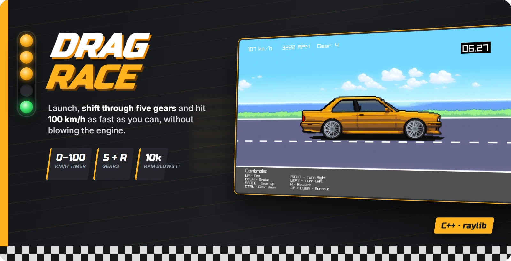
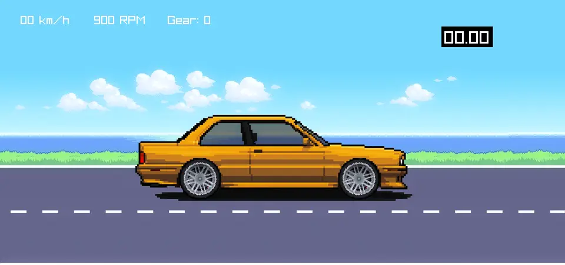
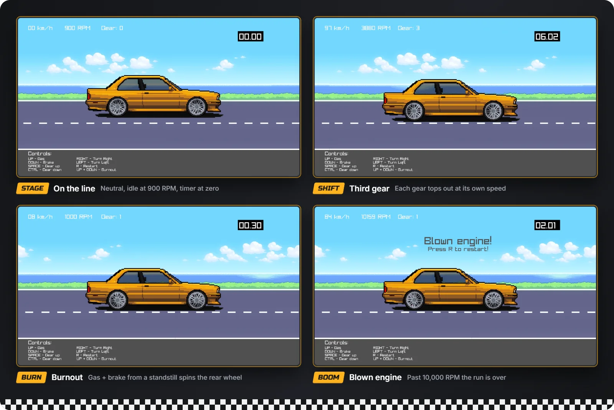

<div align="center">

# DragRace

**Launch, shift, and chase the quickest run to 100 km/h.**

  

[Gameplay](#gameplay) · [Getting started](#getting-started)



</div>

## Overview

DragRace is a compact side-view driving game built around throttle control and manual gear changes. Launch from neutral, shift through five forward gears, and watch the speed, RPM and timer as the scenery scrolls past.

The sprint timer stops once the displayed speed exceeds **100 km/h**. Reverse, braking, lateral movement and a burnout mode add room to experiment, while exceeding **10,000 RPM** blows the engine and ends the attempt.

## Features

| Drive | Read the run |
| --- | --- |
| **Five forward gears**, neutral and reverse | **Speed, RPM and gear HUD** |
| **Throttle, brake and lateral movement** | **Sprint timer** that starts when a gear is engaged |
| **Burnouts and engine failure** | **Scrolling road and rotating tyres** |

## Gameplay





The recording uses the actual game code with scripted inputs. Decorative start lights and racing graphics frame the captures.

## Controls

| Input | Action |
| --- | --- |
| `↑` | Throttle |
| `↓` | Brake |
| `Space` | Shift up |
| Left `Ctrl` | Shift down |
| `←` / `→` | Move laterally |
| `↑` + `↓` from a standstill | Burnout |
| `R` | Reset the run |
| `Esc` | Exit |

Start by pressing `Space` to engage first gear, then hold `↑`. Shift before the engine reaches the failure threshold.

## Getting started

Requires Windows and **Visual Studio 2022** with the **Desktop development with C++** workload and v143 toolset. raylib is bundled.

```bash
git clone https://github.com/HHChandar20/DragRace.git
cd DragRace
```

1. Open `DragRace/game.sln`.
2. Select **Debug / x64** and build the `game` project.
3. Use `DragRace/` (the folder containing `assets/` and `game.sln`) as the working directory.
4. Place `DragRace/libs/raylib.dll` beside the built executable if needed, then run it.

The Debug / x64 solution build was verified. The game opens fullscreen and uses a fixed 1920 × 1080 layout.

## Tech stack

C++ · raylib · Visual Studio solution · Pixel-art textures

Built by [Hakan Chandar](https://github.com/HHChandar20) · 2023.
